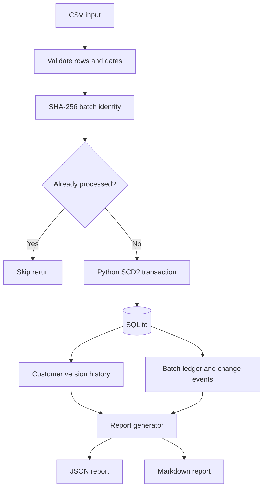

# DAI-037 — Slowly Changing Customer Dimension (SCD Type 2)

A reproducible Python + SQLite data-engineering project that ingests synthetic customer change files, preserves historical customer attributes using **Slowly Changing Dimension Type 2 (SCD2)**, handles exact reruns safely, and emits a structured change report.

## 1. Problem and business objective
Customer attributes such as city and segment change over time. Overwriting a customer's row loses historical context. This pipeline keeps each version, marks one version as current, and records what changed and when.

## 2. Architecture / data flow



Detailed diagram and component notes: [`docs/architecture.md`](docs/architecture.md).

## 3. Technologies
- Python 3.10+ (standard library)
- SQLite (database and transactions)
- CSV input; JSON and Markdown outputs
- `unittest` for automated validation
- No third-party Python packages or external services required

## 4. Project structure
```text
.
├── main.py                  # Command-line interface
├── scd2.py                  # Validation, ingestion and SCD2 rules
├── reporting.py             # JSON and Markdown report generation
├── sql/schema.sql           # Database schema and indexes
├── data/                    # Synthetic CSV input batches
├── tests/test_scd2.py       # Automated tests
├── docs/architecture.md     # Architecture and data flow diagram
├── DESIGN_NOTE.md           # Technical decisions and trade-offs
├── DESIGN_NOTE.pdf          # Design note for reviewers
├── DEMO_SCRIPT.md           # 5–8 minute walkthrough script
└── README.md
```

## 5. Requirements and clean setup
- Python 3.10 or newer
- Git is only needed if you want to clone/version the repository
- No database server or `pip install` step is required

Clone the repository, open a terminal in the project directory, and run:

```bash
python --version
python -m unittest discover -s tests -v
python main.py reset
python main.py load data/customer_changes_1.csv
python main.py load data/customer_changes_2.csv
python main.py report
python main.py show --customer-id C1001
```

The database is created locally as `customer_history.db`. `reset` recreates it, so use that command only when you intend to clear the local demo data. Generated reports appear under `reports/`. The local database and generated reports are excluded from Git by `.gitignore`; the report can be regenerated with `python main.py report`.

## 6. Input data
The included CSV files contain synthetic customer data, not confidential or real customer records. Required columns:

| Column | Purpose |
|---|---|
| `customer_id` | Stable business key |
| `customer_name` | Tracked customer attribute |
| `city` | Tracked customer attribute |
| `segment` | Tracked customer attribute |
| `effective_date` | Date the incoming snapshot becomes effective (`YYYY-MM-DD`) |

All required values must be present. A customer may appear only once in an input batch.

## 7. Data model and SCD Type 2 rules
The schema is defined in [`sql/schema.sql`](sql/schema.sql).

- `dim_customer`: one row per customer version. `customer_sk` is a surrogate key; `customer_id` is the stable business key.
- `effective_from`: inclusive start of the version.
- `effective_to`: exclusive end of the version; `NULL` means the current version.
- `is_current`: `1` for the current row and `0` for a historical row. A partial unique index permits at most one current version per customer.
- `processed_batches`: content batch identity and processing summary.
- `change_events`: before/after values and changed fields for audit/reporting.

First observation inserts a current row. If tracked attributes change, the old row is closed at the incoming effective date and a new current row is inserted. If tracked attributes are unchanged, no new version is created.

## 8. Data quality, idempotency and failure handling
- Required columns, non-empty values, and ISO dates are validated.
- Duplicate `customer_id` values within one CSV are rejected.
- A SHA-256 hash of normalized content is used as the batch ID; exact content reruns are skipped, even if the source filename changes.
- Out-of-order effective dates are rejected rather than silently rewriting history.
- Batch changes are applied transactionally.

## 9. AI component / scope decision
This assigned solution focuses on deterministic data engineering and does **not** call an AI model. The generated JSON report is a structured, machine-readable interface containing `event_type`, `customer_id`, `effective_date`, `changed_fields`, `before`, `after`, and `batch_id`. This keeps the core data pipeline reproducible and avoids introducing an AI dependency where it is not necessary for the stated SCD2 objective. A future optional AI layer could summarize change events, but it should consume the report after deterministic validation and must not be responsible for changing database history. No prompts, credentials, or private data are sent to external services.

## 10. Tests and validation performed
Run `python -m unittest discover -s tests -v`. The seven tests cover:
1. Initial insert creates a current version.
2. Changed attributes preserve the old version and create a new current version.
3. Exact rerun is idempotent.
4. Unchanged attributes do not create a new version.
5. Out-of-order changes are rejected.
6. Duplicate customer IDs in one file are rejected.
7. JSON/Markdown report generation produces output.

The sample pipeline run produced 4 unique customers, 6 total versions, 4 current versions, and 6 change events. Batch 1 processed 3 rows and inserted 3 versions; batch 2 processed 4 rows, inserted 3 versions, and skipped 1 unchanged customer row.

## 11. Assumptions and limitations
- The source files are full customer snapshots/changes with one row per customer per batch.
- `customer_name`, `city`, and `segment` are the tracked attributes.
- `effective_to` is exclusive.
- Late-arriving changes are rejected; no historical backfill/reconciliation policy is implemented.
- SQLite is suitable for a local screening assignment, not a high-concurrency production warehouse.
- No orchestration, monitoring, access-control layer, or LLM integration is included.

## 12. Production improvements
Move to PostgreSQL or a warehouse for concurrent workloads; add orchestration, structured logs/metrics, schema-versioning, stronger batch-level integration tests, a documented late-arriving-data correction policy, and CI. If AI summaries are later required, isolate them behind an optional adapter, validate model output against a schema, and retain deterministic source events as the system of record.

## 13. Design note and demo
- Technical decisions and trade-offs: [`DESIGN_NOTE.md`](DESIGN_NOTE.md) and [`DESIGN_NOTE.pdf`](DESIGN_NOTE.pdf).
- Suggested 5–8 minute demo flow: [`DEMO_SCRIPT.md`](DEMO_SCRIPT.md).

## 14. External resources
- [Python `csv` documentation](https://docs.python.org/3/library/csv.html)
- [Python `sqlite3` documentation](https://docs.python.org/3/library/sqlite3.html)
- [Python `hashlib` documentation](https://docs.python.org/3/library/hashlib.html)
- [SQLite partial indexes](https://www.sqlite.org/partialindex.html)

The implementation uses Python's standard library and SQLite; these references are listed for the underlying APIs and database behavior.
