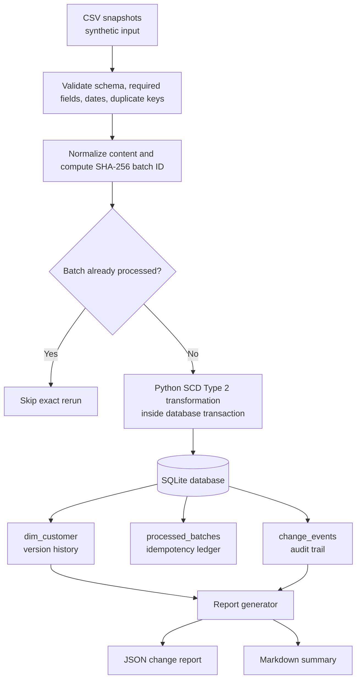

# Architecture / Data Flow — DAI-037

## Main components
- **Input:** public-safe synthetic CSV files in `data/`.
- **Validation:** checks required columns/values, ISO dates, duplicate customer IDs within one file, and out-of-order changes.
- **Batch identity:** SHA-256 content hash supports safe exact reruns.
- **Transformation/storage:** Python applies SCD Type 2 rules in a SQLite transaction.
- **Persistence:** `dim_customer` stores versions; `processed_batches` records processed files; `change_events` stores before/after audit events.
- **Output:** deterministic JSON and Markdown reports. The JSON is an AI-ready interface; this version does not call an LLM or external AI service.

## Failure behavior
A duplicate content hash is skipped. Invalid rows, duplicate business keys in a batch, or out-of-order effective dates are rejected. Transactional processing is intended to prevent a failed batch from leaving partial data changes.
